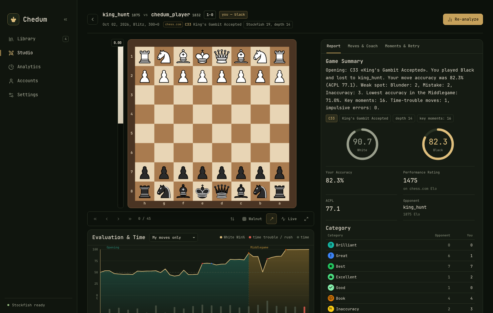
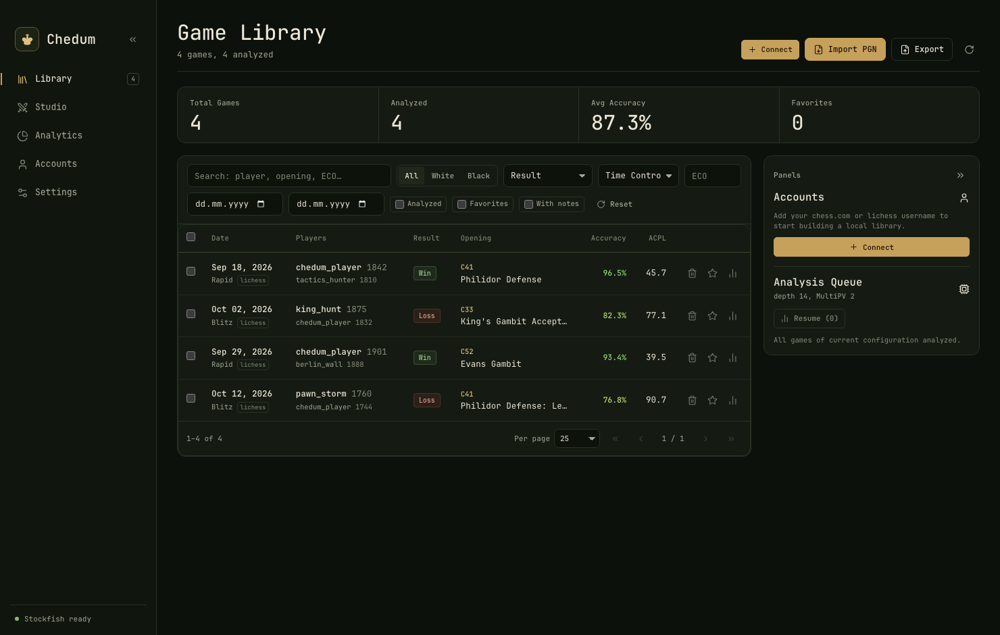
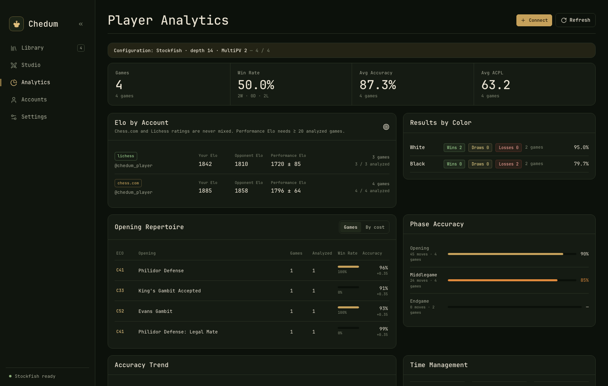

# Chedum

> Fast, private, local-first chess analytics for your desktop.

[](https://github.com/x429d/chedum/actions/workflows/ci.yml)
[](https://github.com/x429d/chedum/actions/workflows/release.yml)
[](LICENSE)

[English](README.md) • [Русский](README.ru.md)

**Chedum** is a desktop chess analytics studio built for players who want deep game review without subscriptions, cloud dependencies, or telemetry. Your games and database stay strictly on your machine.

Built with **Tauri v2**, **Rust**, **SolidJS**, and **Stockfish 19**.

---

## Preview



<details>
<summary><b>More Screenshots (Library & Player Hub)</b></summary>

### Game Library


### Player Hub & Openings


</details>

---

## Highlights

- **Private & Offline-first** — Games are stored in a local SQLite database. No account required, no tracking, and no internet needed after setup.
- **Sync & PGN Library** — Connect Chess.com and Lichess accounts or import PGN files. Filter by opening, opponent, time control, color, or custom notes.
- **Deep Stockfish Analysis** — Local engine evaluation with win-probability graphs, accuracy metrics (CAPS / ACPL), eval bars, and move classification from *Brilliant* to *Blunder*.
- **Coach & Mistake Trainer** — Clear explanations for turning points and an interactive trainer to replay mistakes with immediate engine feedback.
- **Player Hub & Openings** — Track your rating trends, explore your repertoire across 3,800+ ECO lines, and spot weaknesses across openings, middlegames, and endgames.
- **Keyboard-Friendly Board** — Dark interface inspired by Linear and Raycast, multiple piece sets and board themes, move arrows, and full keyboard navigation.

---

## Automated Releases & Installation

All release bundles are built and published automatically via **GitHub Actions** upon creating a release tag (`v*`).

Pre-built binaries are available on the [**Releases**](https://github.com/x429d/chedum/releases) page:

| OS | Architectures / Requirements | Bundles |
| --- | --- | --- |
| **macOS** | 12+ (Apple Silicon & Intel) | `.dmg`, `.app` |
| **Windows** | 10 / 11 (x64, WebView2) | `.msi`, NSIS `.exe` |
| **Linux** | x64 (WebKitGTK 4.1) | `.AppImage`, `.deb` |

Each release automatically bundles the pinned Stockfish 19 binary tailored for your target platform.

### Unsigned builds

Release bundles are not code-signed or notarized yet, so your operating system
may warn you the first time you open Chedum. The binaries are built from this
repository by GitHub Actions; only download them from the official
[Releases](https://github.com/x429d/chedum/releases) page.

**macOS** — open the `.dmg` and drag **Chedum** into **Applications**, then either:

- right-click (or Control-click) **Chedum.app**, choose **Open**, and confirm
  **Open** in the dialog;
- or try to launch it once, then open **System Settings → Privacy & Security**,
  scroll down, and click **Open Anyway** next to the Chedum notice.

If macOS still refuses to launch the app, clear the quarantine flag from
Terminal:

```bash
xattr -dr com.apple.quarantine /Applications/Chedum.app
```

**Windows** — when SmartScreen shows "Windows protected your PC", click
**More info → Run anyway**. The `.msi` and NSIS `.exe` installers are unsigned.

**Linux** — AppImage builds need the executable bit
(`chmod +x Chedum_*.AppImage`), then run the file; the `.deb` package installs
with your package manager as usual.

---

## Tech Stack

- **Desktop shell**: [Tauri v2](https://tauri.app/) (Rust backend)
- **Frontend**: [SolidJS](https://www.solidjs.com/), TypeScript, Tailwind CSS v4
- **Engine**: [Stockfish 19](https://stockfishchess.org/) (bundled sidecar)
- **Database**: SQLite (`rusqlite` with WAL mode)
- **Chess logic**: `shakmaty`, `chessops`, `pgn-reader`
- **CI / CD**: GitHub Actions (automated tests, cross-compilation, and draft release publishing)

---

## Getting Started (Development)

### Prerequisites
- **Node.js** 22+
- **Rust** (stable toolchain)
- Platform build dependencies (see [CONTRIBUTING.md](CONTRIBUTING.md))

### Run locally

```bash
# Install dependencies
npm install

# Download the Stockfish 19 binary for your platform
npm run fetch:stockfish

# Launch in development mode
npm run tauri dev
```

To build a standalone production bundle locally:

```bash
npm run tauri build
```

---

## Data & Storage

Your data stays on your machine. Chedum stores your library and analysis in a single SQLite database:

- **macOS**: `~/Library/Application Support/com.chedum.studio/chedum.db`
- **Linux**: `~/.local/share/com.chedum.studio/chedum.db`
- **Windows**: `%APPDATA%\com.chedum.studio\chedum.db`

Exact paths for the database and log file can be viewed inside the app under **Settings → Diagnostics**.

---

## Project Documents

- [Contributing guide](CONTRIBUTING.md)
- [Code of Conduct](CODE_OF_CONDUCT.md)
- [Security policy](SECURITY.md)
- [Changelog](CHANGELOG.md)
- [Third-party notices](docs/THIRD-PARTY.md)

---

## License & Credits

- Chedum source code is released under the [MIT License](LICENSE).
- Stockfish is licensed under [GPLv3](src-tauri/resources/STOCKFISH-COPYING.txt).
- Piece sets, font, and opening datasets are open-source works credited in [`docs/THIRD-PARTY.md`](docs/THIRD-PARTY.md).
