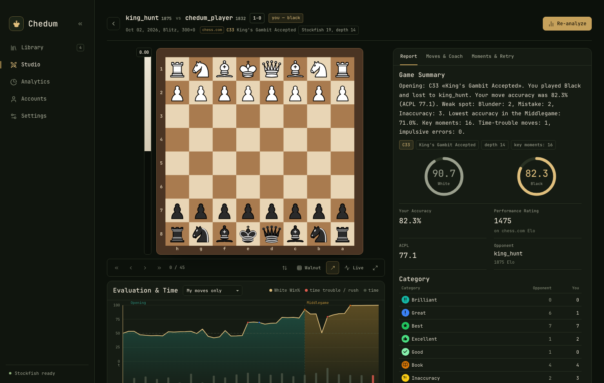
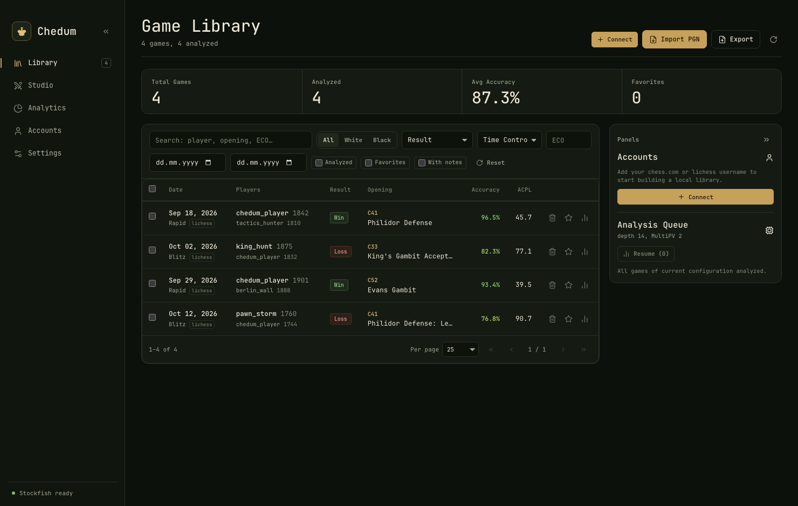
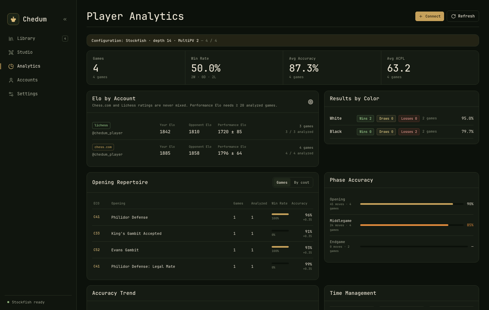

# Chedum

> Быстрый, приватный и удобный шахматный аналитический центр на вашем компьютере.

[](https://github.com/x429d/chedum/actions/workflows/ci.yml)
[](https://github.com/x429d/chedum/actions/workflows/release.yml)
[](LICENSE)

[English](README.md) • [Русский](README.ru.md)

**Chedum** — это десктопное приложение для глубокого анализа партий. Никаких платных подписок, облачных сервисов или сбора телеметрии: библиотека партий и шахматный движок работают исключительно локально.

Стек: **Tauri v2**, **Rust**, **SolidJS** и **Stockfish 19**.

---

## Скриншоты



<details>
<summary><b>Ещё скриншоты (Библиотека и Хаб игрока)</b></summary>

### Библиотека партий


### Хаб игрока и статистика


</details>

---

## Главные возможности

- **Полная приватность и офлайн** — все партии хранятся в локальной базе SQLite. Приложению не нужен аккаунт или интернет после начальной установки.
- **Синхронизация профилей и PGN** — подключайте профили Chess.com и Lichess или импортируйте PGN-файлы. Удобный поиск и фильтры по дебютам, соперникам, контролю времени и тегам.
- **Глубокий анализ со Stockfish** — мгновенный локальный разбор: график вероятности победы, оценка каждого хода, метрики точности (CAPS / ACPL) и классификация ходов от блестящих до грубых зевков.
- **Интерактивный тренер и работа над ошибками** — понятные объяснения ключевых моментов партии и тренажёр для переигрывания ошибок с проверкой движком на лету.
- **Хаб игрока и дебютный репертуар** — наглядная динамика рейтинга, репертуарная матрица на 3 800+ ECO-линий и статистика уязвимых стадий партии (дебют, миттельшпиль, эндшпиль).
- **Отзывчивая доска и тёмная тема** — лаконичный интерфейс в стиле Linear и Raycast, векторные фигуры на выбор, стрелки ходов и полноценное управление с клавиатуры.

---

## Автоматические релизы и установка

Сборка и публикация релизов происходят полностью автоматически через **GitHub Actions** при пуше тега версии (`v*`).

Готовые установщики и бинарники всегда доступны на странице [**Releases**](https://github.com/x429d/chedum/releases):

| ОС | Требования | Форматы пакетов |
| --- | --- | --- |
| **macOS** | 12+ (Apple Silicon) | `.dmg`, `.app` |
| **Windows** | 10 / 11 (x64, WebView2) | `.msi`, NSIS `.exe` |
| **Linux** | x64 (WebKitGTK 4.1) | `.AppImage`, `.deb` |

В каждый релизный пакет автоматически вшивается проверенный бинарник Stockfish 19 для соответствующей платформы.

### Неподписанные сборки

Релизные пакеты пока не подписаны и не нотаризованы, поэтому при первом запуске
операционная система может показать предупреждение. Бинарники собираются из
этого репозитория через GitHub Actions — скачивайте их только со страницы
[**Releases**](https://github.com/x429d/chedum/releases).

**macOS** — откройте `.dmg` и перетащите **Chedum** в **Applications**, затем:

- щёлкните правой кнопкой (или Control-клик) по **Chedum.app**, выберите
  **Open** и подтвердите **Open** в диалоге;
- либо попробуйте запустить приложение один раз, после чего откройте
  **System Settings → Privacy & Security**, прокрутите вниз и нажмите
  **Open Anyway** рядом с уведомлением о Chedum.

Если macOS всё равно не запускает приложение, снимите флаг карантина в
терминале:

```bash
xattr -dr com.apple.quarantine /Applications/Chedum.app
```

**Windows** — когда SmartScreen покажет "Windows protected your PC", нажмите
**More info → Run anyway**. Установщики `.msi` и NSIS `.exe` также не подписаны.

**Linux** — AppImage требует бит исполнения
(`chmod +x Chedum_*.AppImage`), после чего файл можно запустить; `.deb`
устанавливается через пакетный менеджер как обычно.

---

## Стек технологий

- **Десктоп-оболочка**: [Tauri v2](https://tauri.app/) (бэкенд на Rust)
- **Фронтенд**: [SolidJS](https://www.solidjs.com/), TypeScript, Tailwind CSS v4
- **Движок**: [Stockfish 19](https://stockfishchess.org/) (скачивается как сайдкар)
- **База данных**: SQLite (`rusqlite` в режиме WAL)
- **Шахматная логика**: `shakmaty`, `chessops`, `pgn-reader`
- **CI / CD**: GitHub Actions (автоматический прогон тестов, кросс-компиляция и публикация релизов)

---

## Быстрый старт (Разработка)

### Что понадобится
- **Node.js** 22+
- **Rust** (stable toolchain)
- Системные пакеты сборки (см. [CONTRIBUTING.md](CONTRIBUTING.md))

### Запуск проекта

```bash
# Установка зависимостей интерфейса
npm install

# Скачивание бинарника Stockfish 19 под вашу платформу
npm run fetch:stockfish

# Запуск в режиме разработки
npm run tauri dev
```

Сборка готового приложения для текущей ОС:

```bash
npm run tauri build
```

---

## Где хранятся данные

Все данные остаются на вашем компьютере. База партий и результаты анализа сохраняются в единый файл SQLite:

- **macOS**: `~/Library/Application Support/com.chedum.studio/chedum.db`
- **Linux**: `~/.local/share/com.chedum.studio/chedum.db`
- **Windows**: `%APPDATA%\com.chedum.studio\chedum.db`

Точные пути к базе данных и логам всегда можно посмотреть в приложении: **Настройки → Диагностика**.

---

## Документы проекта

- [Руководство для контрибьюторов](CONTRIBUTING.md)
- [Кодекс поведения](CODE_OF_CONDUCT.md)
- [Политика безопасности](SECURITY.md)
- [История изменений](CHANGELOG.md)
- [Сторонние компоненты и лицензии](docs/THIRD-PARTY.md)

---

## Лицензия и благодарности

- Исходный код Chedum распространяется под [лицензией MIT](LICENSE).
- Движок Stockfish распространяется под [лицензией GPLv3](src-tauri/resources/STOCKFISH-COPYING.txt).
- Наборы фигур, шрифты и база дебютов взяты из открытых источников и указаны в [`docs/THIRD-PARTY.md`](docs/THIRD-PARTY.md).
